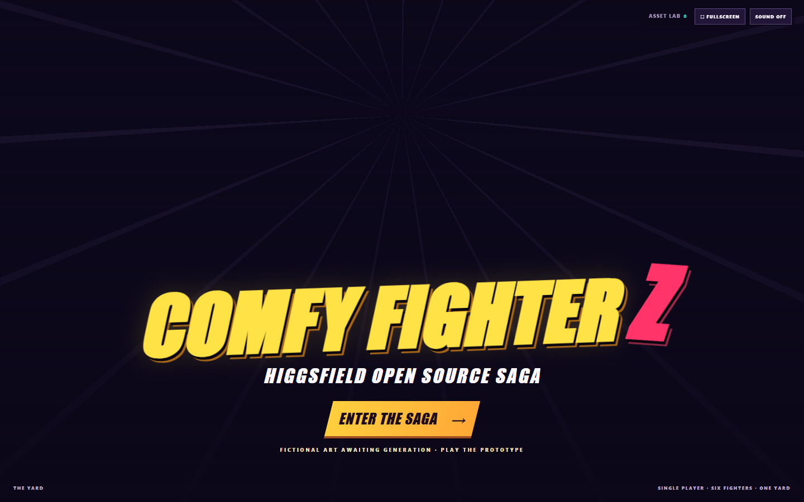
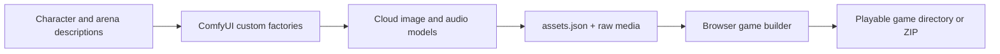
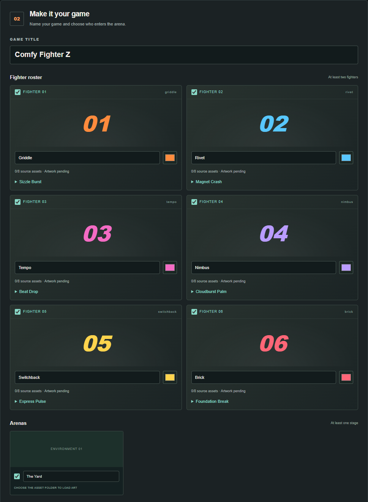
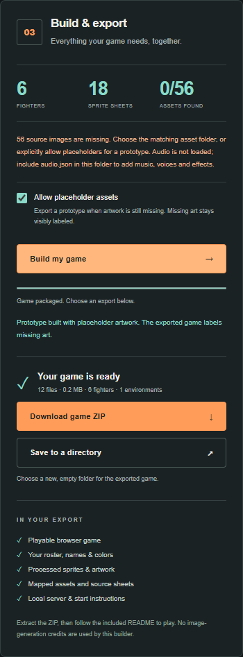
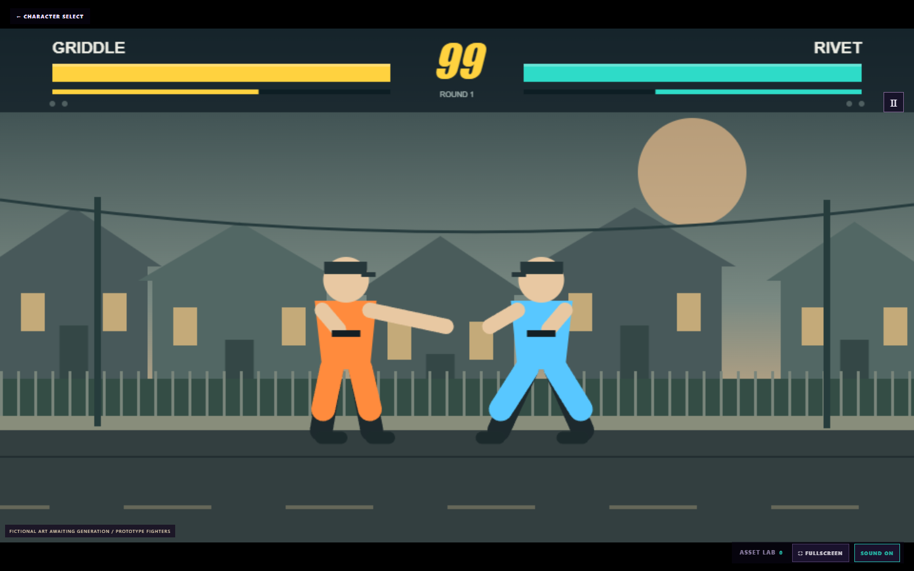

# Comfy Fighter Z — Higgsfield Open Source Saga

Build a browser fighting game from a ComfyUI asset bundle. Describe six fictional fighters, generate their sprites and selection art, add an arena and optional audio, then use the browser builder to export a playable game directory or ZIP.

The game extends the Dad Fighter Z concept: one human-controlled fighter versus the CPU, anime-style introductions, 27 poses per character, projectiles, blocking and best-of-three rounds. The default arena is **The Yard**. Two additional environment factories are available for custom games.

> **Current demo status:** the repository runs as a playable prototype with simple game primitives. Replacement fictional artwork, voices and the opening film have not yet been generated and accepted. The screenshots below show the current interface and explicitly enabled prototype exports—not finished AI artwork. You can follow the free walkthrough without ComfyUI or cloud credits.



*The current title screen. The full game title is Comfy Fighter Z — Higgsfield Open Source Saga.*

## Contents

- [What you will build](#what-you-will-build)
- [Requirements](#requirements)
- [Repository layout](#repository-layout)
- [Quick start](#quick-start)
- [Export a free prototype](#export-a-free-prototype)
- [Set up ComfyUI](#set-up-comfyui)
- [Generate the game artwork](#generate-the-game-artwork)
- [Add music, effects and fighter voices](#add-music-effects-and-fighter-voices)
- [Build a game from generated assets](#build-a-game-from-generated-assets)
- [Play and share your export](#play-and-share-your-export)
- [Automate a complete game export](#automate-a-complete-game-export)
- [Add an optional opening film](#add-an-optional-opening-film)
- [Improve assets without rebuilding everything](#improve-assets-without-rebuilding-everything)
- [Troubleshooting](#troubleshooting)
- [Development and verification](#development-and-verification)
- [Reference guides and privacy](#reference-guides-and-privacy)

## What you will build



The workflow generates the artwork; the builder integrates it into the existing game engine. It does not generate new game code for each character.

| Component | Default result |
| --- | --- |
| Fighters | Six fictional adult parent heroes: Griddle, Rivet, Tempo, Nimbus, Switchback and Brick |
| Animation assets | Three 3×3 sheets per fighter: 27 poses each, 162 poses across the roster |
| Character presentation | Source design, identity reference, selection portrait, full-body hero and special-move cut-in |
| Arena | One fictional backyard, The Yard; two extra environment slots disabled initially |
| Shared art | Title and selection backgrounds, logo, HUD, emblem and combat effects |
| Optional audio | 22 clips: music, effects, announcer calls, specials and six fighter introductions |
| Optional film | A separately generated 25-second opening; Space skips to the title |
| Export | A standalone browser game, source manifests and original media, as a directory or ZIP |

Character descriptions and special-move descriptions guide the generated art. Taglines supply the introduction text and optional spoken lines. Changing a description does not implement a different combat mechanic; those changes belong in the engine code.

## Requirements

| Task | What you need |
| --- | --- |
| Play the repository prototype or use the browser builder | Git, [Node.js 22 or newer](https://nodejs.org/en/download), npm and a modern browser |
| Generate new assets | A local ComfyUI installation, this repository's custom node pack, a signed-in Comfy account, cloud credits and network access |
| Automated exports and browser tests | The dependencies installed by `npm ci`, plus Playwright Chromium |
| Assemble an opening movie | FFmpeg and FFprobe available on `PATH` |
| Adopt generated audio into the canonical demo | FFmpeg available on `PATH` |

All model inference uses cloud/API nodes. You do not need to download image checkpoints for this project. The local ComfyUI server hosts the custom factory code and handles file output; Comfy's Partner nodes perform the model calls. See the [official Partner-node prerequisites](https://docs.comfy.org/tutorials/partner-nodes/overview) for account and connection requirements.

The factories were checked with **ComfyUI 0.43.2**, **frontend 1.57.4** and **Nodes 2.0 enabled**. These are tested versions, not guaranteed minimums. Use a server where you can install this Python pack; uploading the workflow to a managed cloud editor alone does not install its custom nodes.

Commands run from the repository root unless a step explicitly changes directories. Shared commands work in PowerShell and typical POSIX shells; path-variable examples identify their shell.

## Repository layout

```text
comfy-fight-z/
├── comfyui/                 Workflow and asset-generation sources
│   ├── workflows/           Main workflows, focused templates and advanced graphs
│   ├── custom_nodes/        Encapsulated CFZ factories and mapped asset exporters
│   ├── config/              Characters, environments, styles, specials and voices
│   ├── tools/               Workflow preparation and node installation
│   ├── assets/              Image/audio output plans
│   ├── ref/                 Optional new fictional reference inputs
│   └── docs/                Detailed guides and these screenshots
├── build/                   Reusable game and build source
│   ├── public/              Game, browser builder and accepted runtime media
│   ├── tools/               Build, merge, export, adoption and serving commands
│   ├── test/                Unit, custom-node and browser checks
│   └── node_modules/        Installed dependencies; ignored by Git
└── output/                  Generated/local results; ignored except its README
    ├── game/                Current built preview
    ├── test-runs/           Generation plans and source bundles
    ├── exports/             Independent game directories and ZIPs
    ├── assets/generated/    Generated assets and CLI staging
    ├── diagnostics/         Reports, screenshots and recovery backups
    └── private-archive/     Retired private material; never served
```

Root files such as `README.md`, `package.json` and Git configuration remain at the root. `npm ci` installs dependencies in `build/node_modules`. The source folder `build/` is **not** disposable output; `npm run build` replaces only `output/game/`.

## Quick start

Clone and install:

```sh
git clone https://github.com/dhaakon/comfy-fight-z.git
cd comfy-fight-z
npm ci
```

Prepare paths for your checkout, build the preview and start its server:

```sh
npm run workflows
npm run build
npm start
```

- **Game:** <http://127.0.0.1:8080/>
- **Builder:** <http://127.0.0.1:8080/builder/>

`npm run workflows` writes recipes and matching builder downloads. It makes no model calls and needs no running ComfyUI server. Run it after cloning or moving the repository: the shipped JSON contains absolute output paths that must be regenerated for your checkout.

`npm run build` copies the current runtime into `output/game/`. It does not generate artwork or spend credits. Leave the server terminal open; use another terminal at the repository root for the remaining commands. Press Ctrl+C in the server terminal to stop it.

To use the hackathon's port instead, set it before starting the server:

```powershell
# PowerShell
$env:PORT = "8089"
npm start
```

```sh
# Bash / zsh
PORT=8089 npm start
```

Use that port in both URLs. After editing source files or regenerating workflow downloads, run `npm run build` again and reload the browser.

## Export a free prototype

This is the quickest way to learn the complete packaging flow. It uses the example asset map and the builder's explicit placeholder option, without generating images or audio.

1. Open `/builder/` on the running game server.
2. Find **One factory. Your whole game.** Its six character cards and three environment slots match the main template. **TEXT DESIGN READY** means a description is configured; it does not mean the artwork has been generated.
3. Click **Try an example project →**.


*The builder offers a matching workflow download and shows which factories are configured.*

4. Edit **GAME TITLE**, fighter names, colors and selection if desired. Keep at least **two fighters** and **one arena** so the human player has a CPU opponent.
5. Check **Allow placeholder assets**. The example includes mappings, not finished images; a complete-art export rejects the missing files.



*This is the free example map. Missing-art indicators are expected until generated media is supplied.*

6. Click **Build my game**.
7. When the builder reports **Prototype built**, choose **Download game ZIP** or **Save to a directory**.



*This export deliberately uses placeholders. The same controls package a complete generated bundle later.*

Directory export needs a browser with the directory-picker capability and a **new, empty destination folder**. If the button is unavailable, download the ZIP and extract it. Continue with [Play and share your export](#play-and-share-your-export), or generate real assets next.

## Set up ComfyUI

### Install the custom pack into the correct server

Install or launch a local ComfyUI instance using the [official installation guide](https://docs.comfy.org/installation/desktop/windows). Comfy Desktop can manage multiple installations: use the directory for the instance you actually open.

From this repository, run:

```powershell
npm run nodes:install -- --comfy-root "C:\path\to\your\ComfyUI"
```

On macOS/Linux, supply your actual source directory instead:

```sh
npm run nodes:install -- --comfy-root "/absolute/path/to/ComfyUI"
```

That directory must contain **both `main.py` and `nodes.py`**. Do not select the Desktop application directory, `input/`, `output/` or this game's `comfyui/` folder. The installer copies the pack into the selected server's `custom_nodes/dad_fighter_assets/`.

Then:

1. Restart that ComfyUI server.
2. Reload the editor window with F5 or its reload control.
3. Enable **Nodes 2.0** in the editor settings for the interface shown here.
4. Open `comfyui/workflows/comfy-hackathon.json`, or use **Download the main workflow** in the builder's factory panel.

Nodes 2.0 changes the editor's renderer; it does not install the Python classes. If all `CFZ…` nodes still appear as **Unknown pack**, check the installation path, restart the server, and reload the editor before reopening the workflow. An open editor can retain its pre-install node catalog. See [custom-node installation](https://docs.comfy.org/installation/install_custom_node) and [Nodes 2.0](https://docs.comfy.org/interface/nodes-2).

### Understand the main graph


*Twelve functional custom nodes, plus explanatory notes. Native cloud-generation steps are encapsulated inside the factories.*

| Node | What you configure or receive |
| --- | --- |
| **Project Settings** | Absolute output directory, title, subtitle, visual styles, model and seed |
| **Character Factory ×6** | Description, name, special move, tagline, color, ID and source mode |
| **Environment Factory ×3** | Arena description, name, ID, source mode and enabled state |
| **Shared Art** | Menus, logo, HUD, emblem and effects; connected to Environment 1 |
| **Export Game Assets** | Complete mapped `assets.json`, written after the selected assets finish |

No extra third-party sprite node packs are needed for these CFZ cards. The factories expand into installed native cloud nodes; the focused sheet template also uses custom nodes.

## Generate the game artwork

### 1. Pick a fresh output folder

Create an absolute path for this run. In PowerShell at the repository root:

```powershell
$repoRoot = (Get-Location).Path
$bundleRoot = Join-Path $repoRoot "output\test-runs\my-first-game\bundle"
$bundleRoot
```

Copy the printed path into **Project Settings → root_directory**. The factory creates its files there when run. Use a fresh run folder for each new batch; keep previous accepted bundles separately.

If ComfyUI runs on another machine, this must be a path on **that server's filesystem**. Copy the completed bundle back to the machine running the builder afterward.

### 2. Describe the fighters

Keep **source_mode = Invent fictional reference** for a demo made entirely from text. Image selectors can remain empty. Invent mode ignores any image selection and does not load previous-session photos or sheets.


*Names, descriptions, specials and taglines are editable on each factory. This screenshot was captured without running generation.*

Use concrete, consistent descriptions. For example:

```text
Name: Griddle
Description: A fictional cheerful barbecue dad with a broad build,
  a compact auburn beard, brick-red apron, navy trousers and orange cuffs.
Special name: Sizzle Burst
Special description: Plants both feet and launches a compact orange
  energy ball from the forward palm; keep the complete body visible.
Intro tagline: The grill is hot. Your winning streak is toast.
```

Give each fighter a distinct silhouette and outfit. Keep hands and shoes visible in pose instructions. Avoid green clothing: the sprite pipeline removes chroma-green backgrounds.

Keep each **character_id** unique and stable. IDs connect sheets, portraits, introductions and audio. To use your own newly supplied fictional illustration, explicitly choose **Upload reference**, then select that image. Uploading a file while Invent mode is selected does not make it an input.

### 3. Configure the arena

Keep **Environment 1 / The Yard enabled**. Its stage output also feeds shared title and selection art. The default is a fictional backyard with a clear horizontal fighting floor and no decorative speed-line border.

Leave Environment 2 and 3 disabled for the one-level demo. For a custom game with more arenas, describe each setting and enable its factory. Disabled environments generate nothing. Do not replace an unused reference slot with a duplicate Yard image.

### 4. Keep reusable definitions consistent

Edit a graph for a single run. For changes you want to regenerate and share, edit the source configuration:

| File | Controls |
| --- | --- |
| `comfyui/config/factory.json` | Main/focused image-factory defaults, including three environment slots |
| `comfyui/config/game.json` | Canonical game definitions, audio/video recipes and older CLI image plans |
| `comfyui/config/fictional-demo.json` | Separate sample-reference demonstration recipe |

If you change the roster, special names or spoken taglines, keep corresponding definitions in `factory.json` and `game.json` aligned, then run:

```sh
npm run workflows
npm run build
```

Graph edits do not write back to these files. Regeneration replaces recipes with their configured defaults. The image exporter preserves metadata edited on the character cards, but those edits do not automatically update the separate audio workflow.

### 5. Review cost, then run

Sign in to Comfy and review live cloud cost indicators before submitting. Opening a workflow, editing text, preparing recipes and building a game do not spend model credits; running generation does.

| Complete image batch | Paid image calls | Mapped image records | Approximate image cost |
| --- | ---: | ---: | ---: |
| Six invented fighters + one arena | 56 | 56 | $3.20 |
| Six invented fighters + three arenas | 60 | 60 | $3.48 |
| Six uploaded designs + one uploaded arena reference | 49 | 56 | $2.83 |
| Six uploaded designs + three uploaded arena references | 51 | 60 | $2.98 |

These estimates use installed node rates recorded on November 3, 2026; actual billing may vary. Audio, video and repairs are additional. Counts describe a complete uncached run, not a billing cap. When an agent submits jobs for you, approve the specific batch before submission.

Run the main workflow in ComfyUI and monitor it until the final exporter finishes. If it fails partway through, inspect the queue/history and error before retrying; a failed overall workflow can still contain completed paid requests.

### 6. Review the resulting bundle

The one-arena bundle contains 56 image records: 48 character records, two arena records and six shared-art records. Its folder looks like this:

```text
my-first-game/bundle/
├── assets.json
└── raw/
    ├── <fighter>_source-<hash>.png
    ├── <fighter>_reference-<hash>.png
    ├── <fighter>_sheet-<hash>.png
    ├── <fighter>_sheetB-<hash>.png
    ├── <fighter>_sheetC-<hash>.png
    └── ...portraits, heroes, cut-ins, stage and shared art
```

`assets.json` records roster metadata, relative file paths, hashes and pose mappings. Preserve the **whole folder**. Do not rename media independently of the manifest or combine JSON from one run with images from another.

Inspect all three sheets for each fighter: nine poses per sheet, complete limbs, consistent identity and scale, right-facing attacks, separated silhouettes and margin around feet. Check each stage edge and the open fighting floor. File validation can catch missing data; it cannot judge whether a generated drawing looks right.

## Add music, effects and fighter voices

Audio is optional. An image-only bundle can already build a playable game.

1. Update names, special names, `introTagline` and stock `introVoice` choices in `comfyui/config/game.json` if you changed the fighters.
2. Run `npm run workflows:audio`.
3. Open `comfyui/workflows/comfy-audio.json` in ComfyUI.
4. Set **Asset Root → root_directory** to the **exact same absolute folder** used by the image factory.
5. Review the separate cost, run the audio workflow, and audition the clips.

**Set that root explicitly:** the shipped image factory and audio recipe currently have different default folder names. Running both defaults without changing them will not put `audio.json` beside `assets.json`.

The workflow uses Sonilo for music and ElevenLabs for effects and stock-voice performances. It creates 22 clips: two music tracks, four announcer calls, four effects, six special calls and six introductions. The configured dialogue/audio is approximately $0.43 at the recorded rates; changed dialogue changes the estimate. No voice cloning is used.

The bundle now contains:

```text
bundle/
├── assets.json
├── audio.json
└── raw/
    ├── ...image files
    └── ...audio files
```

The builder detects `audio.json` automatically. If an audio manifest is supplied, its mapped files must also be present. Without one, the builder reports that audio was not supplied and text introductions still work.

## Build a game from generated assets

1. Open the builder at `/builder/`.
2. Click **Choose asset folder** and select the folder containing `assets.json` and `raw/`. Choose `bundle/`, not just `raw/` or a parent containing several bundles.
3. Confirm the source-file count is complete and expected portraits, stages and sheets are visible. Optional `audio.json` and `video.json` belong in this same folder.
4. Customize the title, fighter names/colors and enabled roster. Keep at least two fighters and one arena.
5. Leave **Allow placeholder assets unchecked** for a complete-art game.
6. Click **Build my game**. When it finishes, download the ZIP or save to a new empty directory.

**Load JSON separately** loads metadata only; the matching folder is still needed to provide source files. Select the factory's `assets.json`, not a ComfyUI workflow JSON or the runtime `assets/manifest.json`.

The builder verifies hashes, removes green backgrounds, segments sheets into poses, computes anchors and packages the runtime. It retains source maps and media so the export can be edited again. Names and accent-color controls change metadata/UI; they do not redraw lettering or recolor details already painted into an image.

## Play and share your export

Extract the ZIP if necessary, open a terminal **inside the exported game folder**, and run:

```sh
npm start
```

No `npm install`, ComfyUI server or cloud account is needed to play an exported game. Node.js 22+ is still required for its included local server. Open the printed URL; the default is <http://127.0.0.1:8080/>. If the repository preview is using that port, stop it with Ctrl+C or choose a different `PORT` for the export.

Do not double-click `index.html`: the game loads its manifest over HTTP. You can also host the exported folder on a static web server. Share the complete ZIP or directory rather than `index.html` alone. `npm start` binds to localhost for local play; use appropriate static hosting when sharing a public URL.



*Current media-free prototype. Generated sprites and arena art enter through the same engine after a complete bundle is supplied.*

| Control | Action |
| --- | --- |
| Left / Right arrows | Move |
| Up arrow | Jump |
| Down arrow | Crouch; modifies normal attacks |
| A | Punch |
| S | Kick |
| D | Heavy strike |
| F | Special attack; requires 30 energy |
| Hold away from the opponent | Block |
| Escape | Pause/resume combat |
| Space | Skip the opening film or fighter introductions |
| FULLSCREEN button | Enter native fullscreen after a click |

Choose **ENTER THE SAGA**, select your fighter and **CPU OPPONENT**, then **LET'S FIGHT**. Combat stays frozen during introductions. Touch controls are available on mobile; sound starts after interaction and can be muted.

An export includes runtime and source maps with different purposes:

| File/folder | Purpose |
| --- | --- |
| `assets/manifest.json` | Runtime map used by the game |
| `assets/source-manifest.json` | Provenance mapping for processed assets |
| `sources/assets.json` and `sources/raw/` | Reimportable source bundle and original sheets/media |
| `build-report.json` | Processed assets, missing files and warnings |
| `README.txt` | Export-specific startup and control instructions |

To customize the export again, select its **`sources/` folder** in the builder. Keep those files when sharing an editable project.

## Automate a complete game export

The CLI uses the same browser compiler, writes a ZIP and directory, and checks the exported game. It requires a **complete generated source bundle**, not the example map alone.

Install Chromium for the pinned Playwright dependency:

```sh
node build/node_modules/playwright/cli.js install chromium
```

On Linux, browser system dependencies may also be required; the [Playwright browser guide](https://playwright.dev/docs/browsers) documents `install --with-deps chromium`. Alternatively set `PLAYWRIGHT_EXECUTABLE_PATH` to an existing compatible Chromium executable.

PowerShell, from the repository root:

```powershell
$repoRoot = (Get-Location).Path
$bundle = (Resolve-Path ".\output\test-runs\my-first-game\bundle").Path
$export = Join-Path $repoRoot "output\exports\my-first-game-001"
npm run build:bundle -- --bundle "$bundle" --out "$export"
```

Bash / zsh:

```sh
npm run build:bundle -- \
  --bundle "$PWD/output/test-runs/my-first-game/bundle" \
  --out "$PWD/output/exports/my-first-game-001"
```

Both paths must be absolute. The export directory must be new or empty and separate from the input bundle. Add `--title "My Custom Game"` if desired. The command starts its own temporary builder server; the preview server need not be running.

On success:

```text
output/exports/my-first-game-001/
├── game/              Standalone playable folder
├── game.zip           Shareable archive
├── build-test.json    Automated verification result
└── ...screenshots     Builder and gameplay evidence
```

Read the report, inspect the screenshots and play a match. Structural/browser checks do not replace a visual review of poses or an audio review of voices and loop joins.

### Install accepted art into the repository demo

Independent exports can have a custom title, a smaller roster or extra arenas. Keep those as independent games. Adoption into this repository's canonical demo requires its configured title, six fighter IDs, Yard stage and complete asset/pose contract.

For a matching verified export:

```powershell
npm run adopt:game -- --game "$export\game"
npm run build:release
```

Run this after the PowerShell export block above, or set `$export` to your verified export directory. Adoption updates `build/public/assets/`, preserves game code and stores the prior runtime under `output/diagnostics/adopt-*/previous-assets/`. FFmpeg is required when converting accepted audio to MP3; browser export and image-only adoption do not require it.

The current pending demo deliberately fails `build:release`. Use normal `build` for its prototype, and adopt a complete accepted bundle before expecting a strict release build to pass. Keep the original source bundle separately from the optimized runtime.

## Add an optional opening film

The game works without a movie. An accepted opening plays before the title; Space skips it. This is a separate, higher-cost generation step.

Prepare the recipes without submitting them:

```sh
node comfyui/tools/prepare-cinematic-workflows.cjs --templates-only
```

Choose **one** of `comfyui/workflows/video/opening-1080p.json` or `opening-720p.json`. Each uses seven custom Fictional Reference nodes and one Seedance 2.5 request for a 25-second film with sound. The default creates fresh fictional designs; it does not automatically reuse the accepted game's identity images, so review character consistency before including it.

Recorded estimates including those references are about **$20.72 at 1080p** or **$8.64 at 720p**. Check live prices and approve this separately if an agent submits it. No film generation is part of `npm run build` or the free prototype walkthrough.

The video Save node writes `comfy-fighter-z/opening/opening-<resolution>_*.mp4` under ComfyUI's configured output directory. Download or copy that completed clip into `output/test-runs/opening/downloaded.mp4`, or use its actual absolute path as `--input` below. The repository does not create that download automatically.

After reviewing the real movie, assemble it with FFmpeg and FFprobe:

```powershell
$repoRoot = (Get-Location).Path
node build/tools/assemble-opening.cjs --input "$repoRoot\output\test-runs\opening\downloaded.mp4" --out "$repoRoot\output\test-runs\opening\video-patch"
```

The assembler validates duration, landscape framing and audio, then writes `video.json` and `raw/opening.mp4`. Merge it into the complete source bundle before exporting:

```powershell
npm run merge:assets -- --base "$repoRoot\output\test-runs\my-first-game\bundle" --patch "$repoRoot\output\test-runs\opening\video-patch" --out "$repoRoot\output\test-runs\my-first-game-with-film"
npm run build:bundle -- --bundle "$repoRoot\output\test-runs\my-first-game-with-film" --out "$repoRoot\output\exports\my-first-game-with-film-001"
```

See the [opening-film guide](comfyui/docs/video-workflow.md) for generation, retrieval, assembly and optional arena-border repair.

## Improve assets without rebuilding everything

Keep the accepted bundle as the base. Generate a replacement into a different folder, review it, then merge by asset ID.

| Focused template | Result |
| --- | --- |
| `comfyui/workflows/factory/character-factory.json` | One character pack, including three individually encapsulated sheet nodes |
| `comfyui/workflows/factory/sprite-sheet.json` | One newly invented identity and one nine-pose sheet |
| `comfyui/workflows/factory/environment-factory.json` | One environment source and stage |

These export **partial** manifests, not complete games. The standalone sheet template invents a new reference; for a repair that must preserve an accepted identity, use the [incremental refresh guide](comfyui/docs/incremental-refresh.md) to prepare a workflow from that identity instead.

After generating and reviewing the replacement:

```powershell
$repoRoot = (Get-Location).Path
npm run merge:assets -- --base "$repoRoot\output\test-runs\my-first-game\bundle" --patch "$repoRoot\output\test-runs\reviewed-patch" --out "$repoRoot\output\test-runs\my-first-game-v2"
npm run build:bundle -- --bundle "$repoRoot\output\test-runs\my-first-game-v2" --out "$repoRoot\output\exports\my-first-game-v2"
```

Repeated `--patch` arguments are supported; later replacements win. Use a new or empty destination. Replacement IDs must already exist in the complete base. Generate a new complete factory bundle for a new roster or additional environments.

For a wider refresh, `comfyui/tools/prepare-saga-patch.cjs` prepares selected art and intro replacements using an explicit accepted `--base`. The [detailed guide](comfyui/docs/incremental-refresh.md) covers reference uploads, individual repairs and canonical `--saga` validation. Preparing, merging, exporting and adopting do not run models; submitting a replacement workflow does.

## Troubleshooting

| Symptom | What to check |
| --- | --- |
| All CFZ nodes show **Missing Node Packs / Unknown pack** | Install the pack into the running instance, restart that server, reload the editor, then reopen the workflow. Nodes 2.0 alone does not install the pack. |
| Native Gemini/audio/video nodes are missing | Check that the running ComfyUI includes the native Partner nodes used by the recipe. This pack does not install those provider integrations. |
| Output directory points to another computer | Run `npm run workflows` after cloning/moving, reopen the recipe, and set a fresh absolute Project Settings directory. |
| The game shows simple prototype fighters | Expected before a complete fictional bundle is generated and accepted. Use the free walkthrough to test packaging, or supply generated media. |
| `build:release` rejects pending artwork | It is enforcing a complete-art release. The pending demo is not a finished generated game. |
| **Missing source images** | Select the folder containing `assets.json` and its mapped media, not `raw/` alone. |
| Several `assets.json` files found | Select one bundle or one export's `sources/`, not a parent containing multiple projects. |
| SHA-256 mismatch | JSON and files do not match. Recover the matching bundle; do not bypass the check. |
| Builder rejects an asset patch | Merge the partial patch into a complete base before building. |
| No audio in the export | Put `audio.json` and its mapped files beside `assets.json`. Image/audio default folders differ until you set them to match. |
| Wrong spoken names or taglines | Update `comfyui/config/game.json`, regenerate audio, and keep IDs/text consistent with the image factory. Canvas edits alone do not update audio. |
| Directory export unavailable | Use **Download game ZIP**. Directory export depends on browser support. |
| Export folder not empty | Pick a new destination rather than overwriting an earlier game or source bundle. |
| Chromium not found | Run `node build/node_modules/playwright/cli.js install chromium`, or set `PLAYWRIGHT_EXECUTABLE_PATH`. |
| `ffmpeg` or `ffprobe` not found | Add the executable to `PATH`; both are needed for movie assembly. |
| Blank game after opening `index.html` | Serve over HTTP. Run `npm start` inside an exported game folder. |
| Port 8080 already in use | Stop the earlier server with Ctrl+C or choose another `PORT`, then use its printed URL. |
| Source/workflow download changes not visible | Run `npm run build` and reload; the preview serves `output/game/`. |
| Clipped feet, missing poses or identity drift | Review/repair the source sheet. JSON validation cannot fix drawing quality. Preserve the nine-pose order. |
| Large bundle will not package | The browser compiler limits selected source data to 512 MB total and individual image/audio inputs to 64 MB. |

## Development and verification

| Command | Purpose |
| --- | --- |
| `npm run workflows` | Regenerate main/focused/advanced image, audio and opening recipes; no model calls |
| `npm run workflows:factory` | Regenerate compact and focused image factories |
| `npm run workflows:audio` | Regenerate the 22-clip audio recipe |
| `npm run workflows:demo` | Prepare the separate sample-reference demonstration and plan; checks live price badges at ComfyUI `127.0.0.1:8188`, but does not submit generation |
| `npm run build` | Copy current accepted/pending runtime into `output/game/` |
| `npm run build:release` | Require a complete accepted runtime before building |
| `npm run build:bundle -- --help` | Show the strict source-bundle export command |
| `npm run merge:assets -- ...` | Merge accepted patches into a separate complete bundle |
| `npm run adopt:game -- ...` | Install verified canonical media into the repo demo |
| `npm test` | Run JavaScript unit/pipeline checks |
| `npm run test:browser` | Check navigation, intros, controls, movie skipping and mobile layout |
| `npm run test:builder` | Check folder loading, validation, customization and ZIP/directory export |

Browser tests need Playwright Chromium as described above. They use synthetic fixtures and make no paid model calls. Reports and test screenshots belong in `output/diagnostics/`.

The older CLI route remains available through `import:assets`, `build:assets` and `build -- --regenerate-assets`. It consumes staged inputs described by `comfyui/assets/plan.json`. Use it deliberately; normal builds preserve accepted runtime media. The portable bundle → browser builder route is the primary walkthrough above.

To refresh these documentation screenshots, build the preview, start the local ComfyUI server, then run:

```sh
node build/tools/capture-readme.cjs
```

The tool uses isolated browser sessions and the explicit prototype flow. It does not submit generation jobs. See the [screenshot guide](comfyui/docs/images/README.md) for connection options and capture details.

## Reference guides and privacy

- [ComfyUI folder guide](comfyui/README.md): generation sources and entry points.
- [Compact factory guide](comfyui/docs/workflow-factory.md): behavior, costs and focused templates.
- [Asset contract](comfyui/docs/asset-contract.md): schemas, pose order and mapped formats.
- [Incremental refresh](comfyui/docs/incremental-refresh.md): identities, repairs and patch merging.
- [Opening film](comfyui/docs/video-workflow.md): Seedance, audio, assembly and stage repair.
- [Build folder guide](build/README.md): game source and packaging tools.
- [Output folder guide](output/README.md): generated files, exports and recovery data.

The shipped defaults invent fictional characters and environments from text. Do not add private photos, retired photo-derived sheets, old movies, credentials or personal screenshots to the demo or documentation. Preserved local archives are excluded from Git and the served game folder. Earlier Git commits can still contain older media; changing the current tree does not erase repository history or downloaded copies.

The contract retains `dad-fighter-assets/v1` for compatibility with Dad Fighter Z. `npm run export:dfz -- --out <fresh-directory>` stages compatible artwork without rewriting another game's engine. Comfy Fighter Z uses original fictional designs and does not bundle franchise characters, artwork or music.
