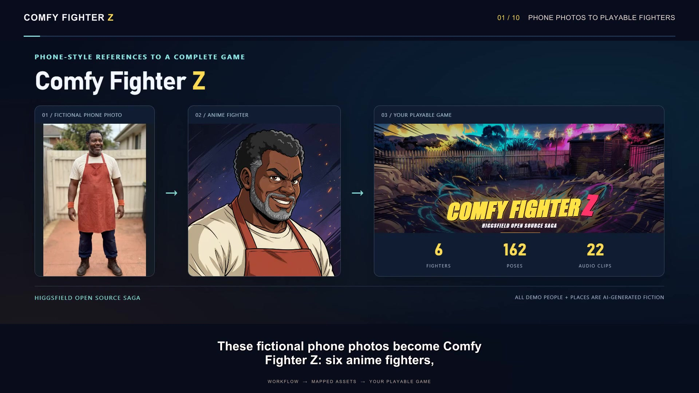
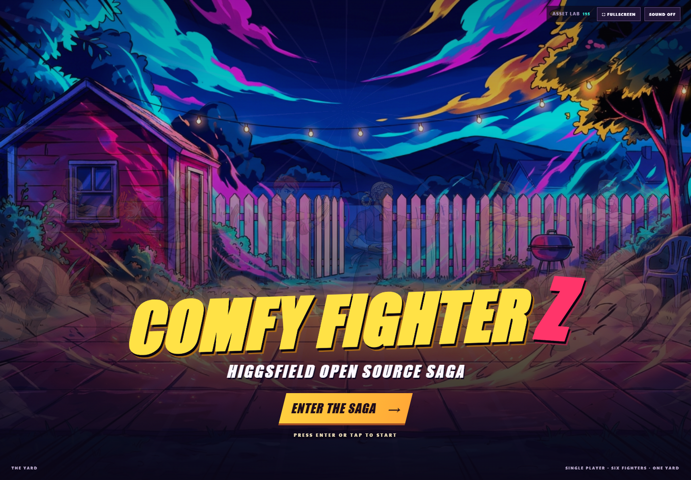
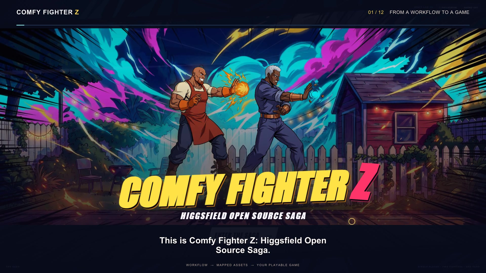
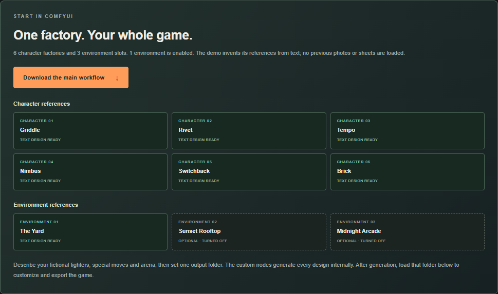
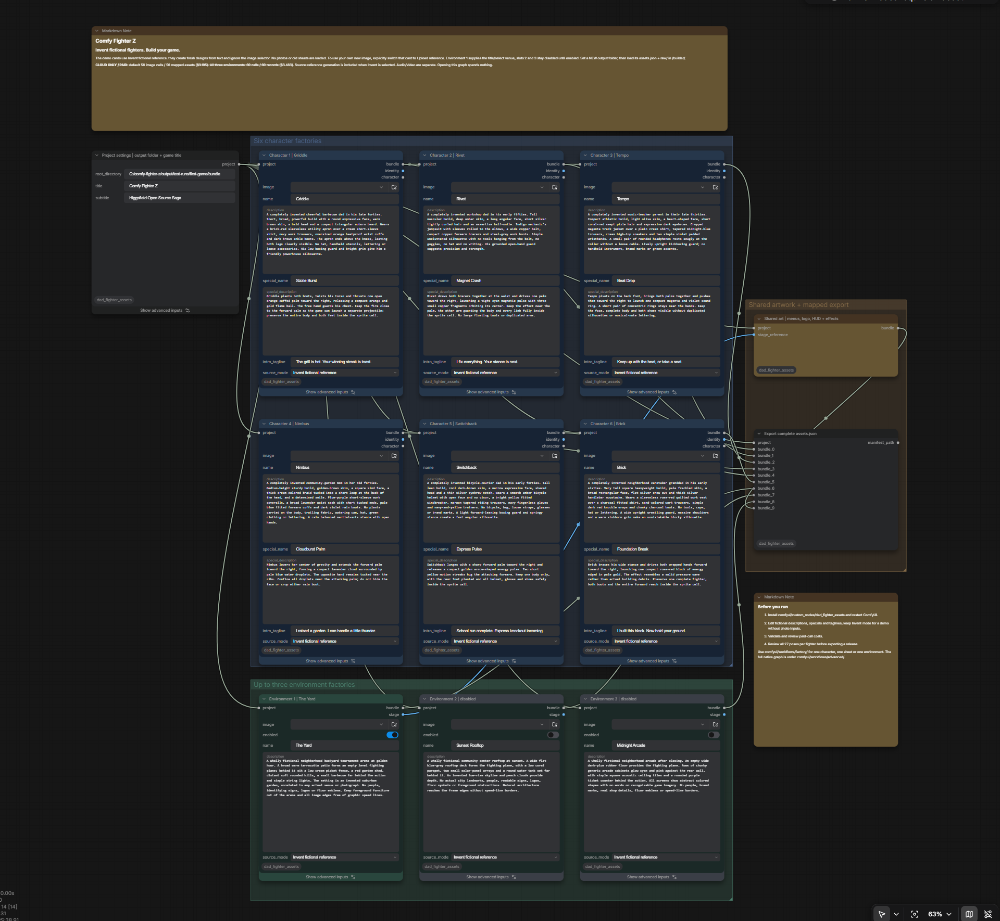
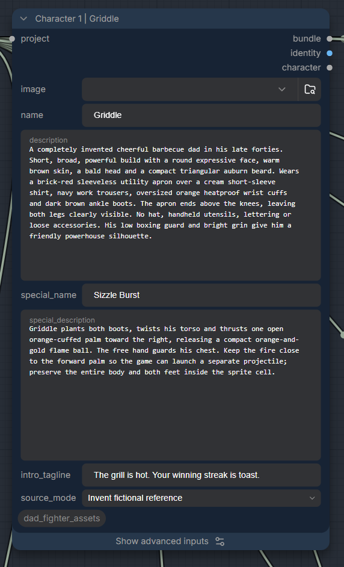
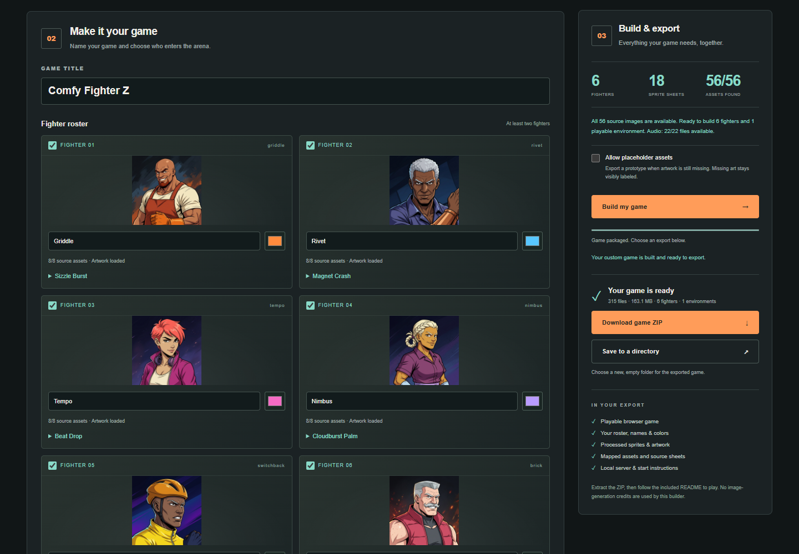
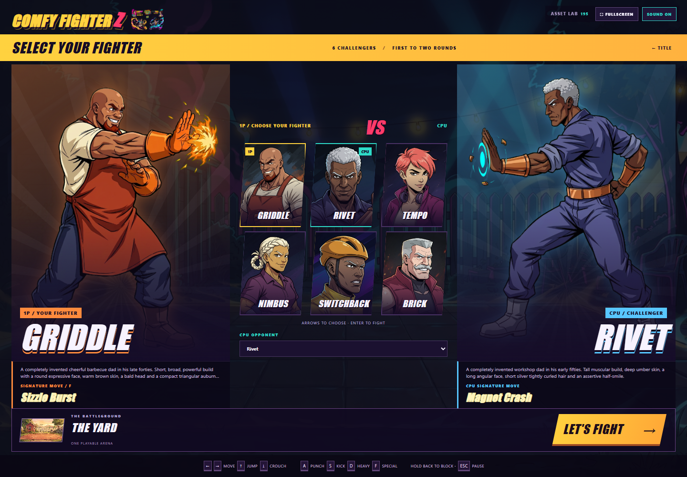
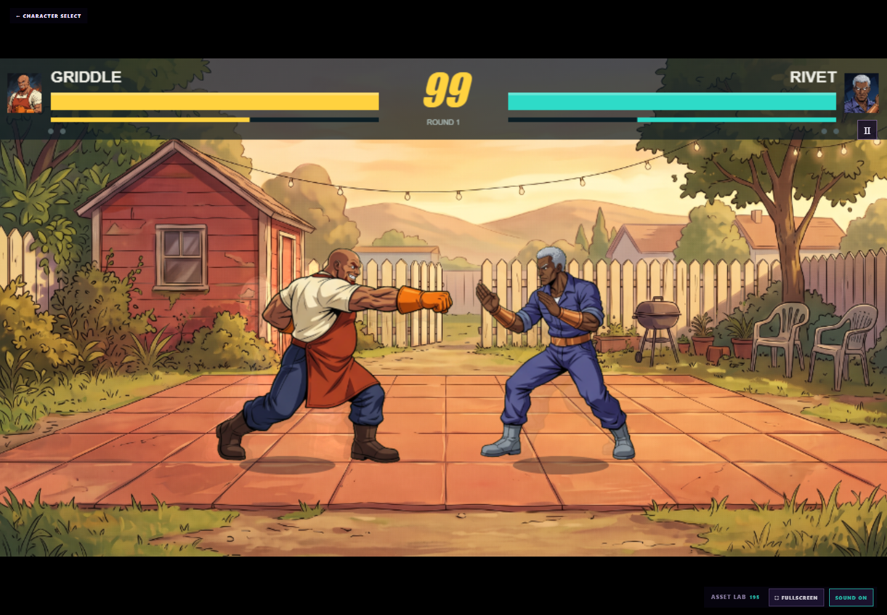

# Comfy Fighter Z — Higgsfield Open Source Saga

Create an anime fighting game with your own fictional cast. ComfyUI generates the artwork; the browser builder turns its asset folder into a playable game directory or ZIP.

The game plays like a late-1990s Neo Geo arcade fighter. **Arcade** mode runs a CPU ladder that ends with a final boss, with continues, win quotes, endings, a staff roll and high scores. **Versus** supports two local players with gamepads, and **Training** adds hitboxes, frame data and a configurable dummy. The fighting system has a three-stock power gauge, supers, guard cancels, rolls, blowbacks and dizzies. **Online Versus** and **Phone / TV** controllers are also available. The presentation uses a restrained arcade palette of charcoal, ivory, oxblood, steel blue and gold.

The included example is the complete arcade cast: six fighters plus the final boss **Baron Bylaw**, three arenas (**The Yard**, **Sunset Rooftop** and **Midnight Arcade**), 45 poses per fighter, ending illustrations and 99 audio clips, all generated by the workflows in this repository. The game uses whatever a bundle provides. Missing arcade in-between poses fall back to the 27 key poses, and a cast without a boss ends the ladder with its last rival.

The gear button opens settings, controls, fullscreen, sound, the asset gallery and the repository link. The title screen offers Arcade, Versus, Training, Online Versus and Phone / TV.

### Generate title and menu artwork

The title screen shows one generated illustration of the whole cast. The main workflow's **CFZ Title Ensemble Art** node makes it for any cast, from each fighter's identity and the first arena. It is saved in the bundle as the `ensemble` image, and **CFZ Menu Video** animates it into the looping menu video (see [step 3](#3-generate-your-artwork)). To redraw only the included cast's picture from existing art, open [`comfyui/workflows/ensemble-title.json`](comfyui/workflows/ensemble-title.json), upload six fictional character design images into the six **Load Image** nodes and edit the prompt. The template is muted until you select images and unmute its nodes. The included example uses fictional images from `example/bundle/raw/*_hero.webp`; the workflow uses one paid cloud image call. Review the result for all six characters before using it. Its default output is in the ComfyUI output folder under `comfy-fighter-z/ensemble-title-20261104/`.

Open [`comfyui/workflows/arcade-title-and-menu.json`](comfyui/workflows/arcade-title-and-menu.json) in ComfyUI. Its four cloud image nodes generate a fictional yard title background, a selection background, a menu frame and an isolated green-background logo. Edit the prompts, game title and output prefixes before running. This workflow has four paid image calls; check the current cost in ComfyUI before generating.

Review each output, especially the spelling of the logo. Put exactly one output per asset into a fresh folder, keeping the default `title-backdrop_00001_.png`, `select-backdrop_00001_.png`, `menu-frame_00001_.png` and `title-logo_00001_.png` naming pattern. Then, after `npm ci`, convert the reviewed images into a separate folder:

```sh
node comfyui/tools/prepare-arcade-ui.cjs /absolute/path/to/reviewed-images /absolute/path/to/new-arcade-art
```

The converter keys the logo's green background and creates four WebP files without making model calls. After reviewing them, copy the four files into `build/public/arcade/` and rebuild your game. The bundled Comfy Fighter Z logo and backgrounds appear for that title; custom game titles retain their own title text and generated backgrounds. The game's clickable labels remain HTML for accessibility and customization.

**[Play the original included demo at comfy-fight-z.dhaakon.com](https://comfy-fight-z.dhaakon.com/)** — no installation required. Use arrow keys and ASDF on a keyboard, or the on-screen controls on mobile. The game's **GITHUB** link opens this repository.

**Download the current multiplayer builds:** [included cast](https://github.com/dhaakon/comfy-fight-z/releases/download/arcade-multiplayer-v1/comfy-fighter-z-arcade-game.zip) ? [fictional phone-photo cast](https://github.com/dhaakon/comfy-fight-z/releases/download/arcade-multiplayer-v1/comfy-fighter-z-phone-photo-arcade-game.zip). Both include the Node server and need no dependency installation.

## Phone snapshots to a new game — 2:00 walkthrough

> **Verified new demo:** six fictional fighters, The Yard, 162 poses and 22 game-audio clips. The artwork passed visual review, the game passed strict export and control checks, and the public deployment was checked on desktop and mobile.

[](https://github.com/dhaakon/comfy-fight-z/releases/download/phone-photo-demo-v1/comfy-fighter-z-phone-photo-demo.mp4)

**[Watch the 2:00 walkthrough](https://github.com/dhaakon/comfy-fight-z/releases/download/phone-photo-demo-v1/comfy-fighter-z-phone-photo-demo.mp4)** · **[Play the new photo-to-game demo](https://comfy-fight-z.dhaakon.com/phone-photo-demo/)** · **[Download the current game ZIP](https://github.com/dhaakon/comfy-fight-z/releases/download/arcade-multiplayer-v1/comfy-fighter-z-phone-photo-arcade-game.zip)**

ComfyUI invents six adults and a backyard as realistic phone snapshots, then uses those seven uploaded images to create **six anime fighters, The Yard, 162 poses and 22 game-audio clips**. No real-person photos or earlier game artwork are inputs. The narrated walkthrough shows generation, visual review, the builder and gameplay.

[Follow the photo-to-game guide](example/phone-photos/README.md) for the seven source PNGs, workflows and upload controls. The game ZIP (about **199 MiB**) includes a reusable `sources/` folder: extract the game, run `npm start`, or select `sources/` in this repository's builder to customize it. [Transcript](https://github.com/dhaakon/comfy-fight-z/releases/download/phone-photo-demo-v1/comfy-fighter-z-phone-photo-demo.transcript.txt) · [Subtitles](https://github.com/dhaakon/comfy-fight-z/releases/download/phone-photo-demo-v1/comfy-fighter-z-phone-photo-demo.srt).

This new demo stays separate from the included `example/bundle/`, the original public game and `npm run example` below. Its reviewed generation used **61 image calls, 22 game-audio clips and 10 narration clips**, including five image repairs; the recorded estimate is **$4.30**, not a provider billing statement.

## Included example

> **Included example:** six fictional fighters and a final boss, three arenas, 315 poses, seven endings and 99 music, announcer, effect and voice clips: 89 images in all. The reviewed assets are included in [`example/`](example/README.md), so building this game requires no ComfyUI server, cloud account or generation credits. Regenerating the assets is optional. The arcade material was added to the earlier six-fighter release with the [arcade expansion](#optional-expand-a-classic-bundle-to-the-arcade-cast) for **$4.57** of cloud generation, including three sheet repairs.



*The included example, built from the fictional artwork in `example/bundle/`.*

### Earlier walkthrough — 2:53

[](https://github.com/dhaakon/comfy-fight-z/releases/download/explainer-v1/comfy-fighter-z-explainer.mp4)

**[Watch or download the video — 2:53, 1080p](https://github.com/dhaakon/comfy-fight-z/releases/download/explainer-v1/comfy-fighter-z-explainer.mp4)** · [Transcript](https://github.com/dhaakon/comfy-fight-z/releases/download/explainer-v1/comfy-fighter-z-explainer.transcript.txt) · [Subtitles](https://github.com/dhaakon/comfy-fight-z/releases/download/explainer-v1/comfy-fighter-z-explainer.srt)

This earlier video shows the two-fighter prototype and its workflow. It predates the included arcade bundle and the phone-photo demonstration above; use the current build commands below.

## 1. Build the included example

Install [Node.js 22 or newer](https://nodejs.org/en/download) and Git, then run:

```sh
git clone https://github.com/dhaakon/comfy-fight-z.git
cd comfy-fight-z
npm ci
npm run example
npm start
```

Open **[the builder](http://127.0.0.1:8080/builder/)** or **[the game preview](http://127.0.0.1:8080/)**. Leave the server terminal open and use a second terminal for later commands.

`npm run example` checks the included assets, builds and tests a game directory and ZIP, then installs the game in `output/game/`. It installs the pinned Chromium browser once if needed. Later builds use the installed browser; there are no model calls. The command prints the export paths.

To customize these assets, choose the repository's **`example/bundle/` folder** in the builder and continue at step 4. To generate a new cast, follow the steps below or the [combined example workflow guide](example/README.md).



## 2. Connect ComfyUI

For generation, use a local [ComfyUI installation](https://docs.comfy.org/installation/desktop/windows), a signed-in Comfy account and cloud credits. All models run through cloud/API nodes; no image checkpoints are needed.

Install this project's custom nodes into the ComfyUI instance you actually run:

```powershell
npm run nodes:install -- --comfy-root "C:\path\to\your\ComfyUI"
npm run workflows
```

On macOS/Linux, replace the path with your absolute ComfyUI directory. It must contain **`main.py` and `nodes.py`**—not this game's `comfyui/` folder. ComfyUI Desktop installs keep custom nodes in their base folder (usually `Documents\ComfyUI`) instead; for those, pass `--base-directory` with that folder, for example `npm run nodes:install -- --base-directory "C:\Users\you\Documents\ComfyUI"`.

Restart ComfyUI, reload its editor, then open **`comfyui/workflows/comfy-hackathon.json`**. You can also download this workflow from the builder. Enable **Nodes 2.0** for the interface shown here; that setting changes the renderer and does not install missing nodes.

The tested setup is ComfyUI 0.43.2 with frontend 1.57.4. See [Comfy's Partner-node requirements](https://docs.comfy.org/tutorials/partner-nodes/overview) for authentication and network setup.

### Renderer

The arena draws with PixiJS (WebGL) when the browser supports it, and falls back to Canvas 2D otherwise; the HUD stays on a 2D overlay either way. Add `?renderer=canvas` to the game URL to force the fallback. The library is vendored in the exported game (`vendor/pixi.min.js`, MIT), so nothing is installed or fetched at play time.

## 3. Generate your artwork



The main workflow contains Project Settings, six Character Factories, a **Final boss** factory, three Environment Factories, Shared Art and the art exporter. Sheets B to E take sheet A as a second reference so scale, line weight and facing stay consistent, and the builder normalizes every standing pose to the idle cel per sheet; a reviewed sheet record can also list cells to flip in `"mirror": ["run2"]` when the model drew them facing the wrong way. It also generates the startup screen and videos:

- **CFZ Title Ensemble Art**: one key illustration of the cast caught mid-battle in the arena, shown behind the title menu.
- **CFZ Menu Video**: an eight-second silent loop of that picture, with the fighters trading a flurry of blows before slamming back into the opening clash.
- **CFZ Select Video**: an eight-second silent loop of the character-select backdrop (lights, embers, camera drift).
- **CFZ Select Idle Video**: one portrait keyframe and a six-second idle-stance loop per fighter; the character-select cards play it start to finish, hold a beat, and start again.
- **CFZ Fighter Intro Video**: one four-second, Dragon Ball Z-style clip per fighter (aura burst, dash, signature strike). Both fighters' clips play together on a split screen before the fight.
- **CFZ Export Videos**: writes `video.json` beside `assets.json`.

If a clip is missing or can't play, the game falls back to the still image and the animated sprite entrance.

1. In **Project Settings**, set `root_directory` to a **fresh absolute folder**, such as `C:\games\comfy-fight-z\output\test-runs\my-game\bundle`. This is where ComfyUI writes the bundle; use a path on the ComfyUI server's machine.
2. Edit each character's name, description, special move and introduction tagline. The optional arcade fields set the fighting style, super move, win quote and ending text. Choose **Final boss** as the `role` for at most one character; Arcade mode hides that character from selection and saves them for the last match. Keep each `character_id` unique and stable.
3. Keep **Invent fictional reference** selected to create designs entirely from text. Image selectors can stay empty. To supply your own artwork, follow [Use your own source images and backgrounds](#use-your-own-source-images-and-backgrounds).
4. All three environments are enabled for the arcade ladder: **The Yard**, **Sunset Rooftop** and **Midnight Arcade**. Disable Environments 2 and 3 for a one-arena game; disabled slots make no model calls.
5. Review the cloud cost, then run the workflow and wait for the final exporter to finish.

**Workspaces limited to one job at a time** (such as a free plan) can fail with "rate limit" (HTTP 429) errors, because ComfyUI starts every ready cloud call at once. In that case, export the workflow in API format (**Workflow → Export (API)**) and run it one paid call at a time:

```sh
node comfyui/tools/run-sequential.cjs --workflow /absolute/path/to/workflow.api.json
```

Each step adds one paid node and reuses the earlier, cached results, so a finished call is never billed twice. A final run of the whole workflow writes the manifest from that cache. The runner stops if ComfyUI ever re-executes an earlier paid node. Keep ComfyUI running and don't queue other work until it finishes.



Descriptions guide the artwork. The fighting style selects each character's special-move set and speed and damage profile, and costs nothing to change. Give fighters distinct silhouettes and outfits. Avoid green clothing because the sprite processor removes chroma-green backgrounds.

| Complete image batch | Paid image calls | Approximate cost |
| --- | ---: | ---: |
| Six invented fighters + final boss + three arenas, 45 poses each | 90 | $5.33 |
| The same cast with The Yard only | 86 | $5.05 |
| Classic set: six fighters + The Yard, 27 poses, no boss or endings | 57 | $3.24 |
| Startup image and videos for seven fighters (15 images + 16 silent LTX clips, 86 seconds) | 15 | $11.81 |

Each fighter costs 11 image calls with arcade art (source, identity, five sheets, portrait, hero, cut-in, ending), or 8 for the classic 27-pose set. The startup media add one intro keyframe and one four-second clip plus one portrait idle keyframe and one six-second loop per fighter (about $1.39), plus the ensemble, its eight-second loop and the eight-second select-screen loop (about $2.13). To build the classic set, disable `include_arcade_art`, delete the boss factory and disable the extra arenas. Estimates use recorded November 3, 2026 rates; actual billing may vary. Audio, video and repairs cost extra. Running generation spends credits; opening or editing a workflow does not. If an agent submits it for you, approve the specific batch first.

**Try everything with two fighters first.** This command prepares one priced workflow and submits nothing:

```sh
node comfyui/tools/prepare-duo-run.cjs --out output/test-runs/my-duo
```

It covers two fighters in The Yard: all game art, the startup image, the menu video, two fight intros and 61 audio clips. That is 36 images, 6 clips and 61 audio clips, about **$7.68** (a run with six-second intros on November 4, 2026 billed $5.79). Run its `workflow.api.json` with the sequential runner described above, then export `bundle/` in step 4.

The completed folder contains:

```text
bundle/
  assets.json
  raw/
    ...character designs, sheets, portraits, stages and shared artwork
```

Keep the whole folder together. Review every sheet per fighter for complete hands and feet, consistent identity and nine correctly ordered poses. There are three key sheets (A–C, 27 poses) and two arcade sheets (D–E, 18 in-between, wind-up and status poses). A valid file cannot guarantee a good drawing.

### Use your own source images and backgrounds

Open **`comfyui/workflows/comfy-hackathon.json`** after completing step 2. This main template supports uploaded references; `example:prepare` is reserved for the text-generated fictional example. Save a separate copy of the workflow and set **Project Settings → `root_directory`** to a fresh absolute output folder for your custom game.

Prepare PNG, JPEG or WebP images with clear designs:

| Input | What works well |
| --- | --- |
| Character reference | One fictional character per image, with a clear face, outfit, complete hands and feet, and room around the figure. Avoid green clothing because the generated sheets use a green background for sprite extraction. |
| Background reference | A wide, preferably 16:9 scene viewed from the side, with clear ground near the bottom and scenery behind the fighting area. Keep the floor free of foreground obstacles and decorative borders. |

**Add your characters:**

1. In a **Character Factory**, change `source_mode` to **Upload reference**.
2. Use the upload control beside **`image`** to select your file, then confirm its filename is selected. ComfyUI stores it in the running server's input folder. Uploading through the editor also works when the server is on another machine; select the uploaded filename rather than entering an absolute path.
3. Update `name` and `description` to match your character, then edit `special_name`, `special_description` and `intro_tagline`. Keep a unique, stable `character_id` and leave **`include_sprite_sheets` enabled** in the advanced fields.
4. Repeat for each character you want to replace. Other slots can stay in **Invent fictional reference** mode to generate their designs from text. That mode ignores the `image` selection.

Each character factory uses the reference to generate an anime identity and five 3×3 sheets containing **45 poses**: 27 key poses plus 18 arcade in-betweens. It also creates a selection portrait, a full-body hero, a super-move cut-in and an ending illustration. The description, special-move, super-move and ending fields guide those images. With `include_arcade_art` off, a factory makes the classic three sheets and no ending.

**Add your backgrounds:**

1. In **Environment 1**, keep `enabled` on, switch `source_mode` to **Upload reference**, and upload/select your background through `image`.
2. Change the environment `name` and `description` to match the scene. The factory generates a playable arena from this reference; the supplied image is a guide for its layout and appearance. Environment 1 also supplies the setting for the title and selection artwork, so keep its connection to **Shared Art** intact.
3. For a one-arena game, disable Environments 2 and 3. To replace their arenas, select **Upload reference** before uploading an image, or keep **Invent fictional reference** selected and describe the scene in text. Keep each `stage_id` unique. The template supports up to three environments, and Arcade mode rotates through them.

Review the cloud cost and run the workflow. Uploading alone makes no model calls; generation uses cloud credits. Once the final exporter finishes, choose the **complete generated folder containing `assets.json` and `raw/`** in the builder. Select at least two fighters and one arena, then follow [step 4](#4-export-your-game) to export. With several arenas, Versus and Training show an arena selector (◀ ▶) on the selection screen, and Arcade rotates through them.

Uploaded references are saved in the bundle and retained in the exported game's `sources/` folder, so use artwork you intend to include when sharing the game. For the public demo, keep character and location designs fictional. To change only one sheet or character in an existing bundle, see [incremental asset updates](comfyui/docs/incremental-refresh.md).

### Optional: add sound

Open **`comfyui/workflows/comfy-audio.json`**, set its **Asset Root to the same folder** as the image workflow, and run it after reviewing the separate cost. It adds `audio.json` and **99 clips**, about **$1.76** for the default text:

| Group | Clips |
| --- | --- |
| Music | 10: title, select, one theme per arena, boss, victory, continue, game over and ending (503 seconds) |
| Announcer | 20 stock-voice calls: title, select, versus, rounds, final round, ready, go, KO, double KO, time over, perfect, draw, victory, you win/lose, continue, game over, final battle |
| Effects | 20: hits, blocks, whiffs, jumps, landings, dashes, throws, supers, KO, counter, dizzy, menu sounds and the timer |
| Fighter voices | 7 per fighter in their configured stock voice: introduction, special, super, attack, hurt, KO and win |

The game routes music, effects and voices through separate volume controls and ducks music under voices. If you changed fighter names, move names, taglines or character/stage IDs, update the corresponding fields in `comfyui/config/game.json` and run `npm run workflows:audio` before opening the audio graph. Keep audio IDs aligned with the image bundle. Canvas edits in the image workflow do not update audio automatically. Voices use stock presets, without voice cloning.

### Optional: expand a classic bundle to the arcade cast

A six-fighter bundle with 27 poses (the earlier classic release, or your own) can grow into the arcade cast without redrawing its fighters. This is how the included example was made. Run this command with your accepted bundle as `--base`. It writes a priced expansion run and submits nothing:

```sh
npm run workflows:expansion -- --base example/bundle --out output/test-runs/my-expansion
```

The run keeps the six reviewed identities. It copies their accepted reference images into `uploads/` and generates only the new material: two arcade sheets and an ending per fighter, the final boss's complete set, Sunset Rooftop and Midnight Arcade. That is **33 image calls (about $2.09)**, plus the complete **99-clip audio set (about $1.76)**. The run contains `images.workflow.json`, `audio.workflow.json`, API versions of both and a `plan.json` with the estimates and next steps.

1. Copy `uploads/*.png` into the ComfyUI server's input folder without renaming them, then open both workflows and review the cost.
2. After generation, review every sheet, ending and arena, and listen to the clips.
3. Merge onto the accepted bundle. `--saga` validates against the current plans and retires clips the plan no longer uses:

   ```sh
   node build/tools/merge-bundles.cjs --saga --base example/bundle --patch output/test-runs/my-expansion/patch --patch output/test-runs/my-expansion/audio --out output/test-runs/my-expansion/merged
   ```

4. Load the merged folder in the builder ([step 4](#4-export-your-game)), or export it from the command line with `npm run build:bundle` ([advanced guide](comfyui/docs/advanced.md#export-from-the-command-line)).

### Optional: add videos to an existing bundle

The main template generates the menu video and fight intros. To add clips to a bundle you already have, use the templates and helpers below.

#### Fighter introductions

Use [`ltx-intro-single.json`](comfyui/workflows/ltx-intro-single.json) for one fighter, or [`ltx-intro-six-fighters.json`](comfyui/workflows/ltx-intro-six-fighters.json) for a six-fighter batch. Both use the cloud LTX 2.5 Fast node to create eight-second 720p clips. The templates are muted: upload a fresh, complete 16:9 first-frame image for each fighter, edit the action prompts, and unmute the nodes before running. Use fictional character designs for the public demo. Review the current cloud cost in ComfyUI; the six-clip November 2026 node estimate was $6.18. Generated videos are silent; the game plays the existing character tagline separately.

Review the full clips for identity, hands, and motion. Copy the accepted MP4s into a fresh folder as `griddle.mp4`, `rivet.mp4`, and so on, matching your bundle's fighter IDs. To add them to a **new copy** of a complete asset bundle, run:

```sh
node build/tools/assemble-fighter-intros.cjs --bundle /absolute/path/to/bundle --clips /absolute/path/to/reviewed-clips --out /absolute/path/to/new-bundle
```

The tool checks H.264 compatibility and an approximately eight-second duration, copies the media, and writes `video.json` with hashes and fighter mappings. Add `--fighters griddle,rivet` to include only selected clips. It never submits a model call or replaces the source bundle. Open the new bundle in the builder and export normally. During play, the two videos run before the round with combat frozen; Space skips them. If a clip cannot load, the existing animated sprite intro remains available. The checked-in `example/bundle` remains a free, offline example without generated videos.

#### Animated title and opening

Open [`ltx-title-animation.json`](comfyui/workflows/ltx-title-animation.json) for a looping title and [`ltx-opening-animation.json`](comfyui/workflows/ltx-opening-animation.json) for a short startup film. Each takes a single 16:9 reference image and uses one paid LTX 2.5 Fast cloud call to generate a silent eight-second 720p video. The title workflow uses the same first and last reference frame to help the loop. Both templates are muted until you upload an image and unmute the nodes. Use fictional artwork for a public demo and review the complete videos before building.

Add the reviewed files to a **fresh** copy of an existing asset bundle without regenerating its art, sound, or fighter intros:

```sh
node build/tools/assemble-title-videos.cjs --bundle /absolute/path/to/bundle --title /absolute/path/to/title.mp4 --opening /absolute/path/to/opening.mp4 --out /absolute/path/to/new-bundle
```

The helper validates each video and writes their paths, durations, and hashes into `video.json`, retaining any mapped fighter intros. Load the new bundle in the browser builder, or run `npm run build:bundle -- --bundle /absolute/path/to/new-bundle --out /absolute/path/to/fresh-export`. The exported game plays the opening before the animated title; Space skips it. If the title video cannot play or reduced motion is enabled, the still title artwork remains visible.

## 4. Export your game

In the [builder](http://127.0.0.1:8080/builder/):

1. Click **Choose asset folder** and select the folder containing `assets.json` and `raw/`.
2. Check the asset inventory. Customize the title, names, colors and roster; keep at least **two fighters and one arena**.
3. Leave **Allow placeholder assets unchecked** for a game using complete generated artwork.
4. Click **Build my game**, then **Download game ZIP** or **Save to a directory**.



*The builder after a strict build (shown with the earlier six-fighter release). Download the finished ZIP or save its directory.*

Directory export needs a supported browser and a new, empty destination. Use ZIP if that option is unavailable. Selecting JSON alone loads metadata; the matching media folder is still required.

The export includes the game, processed sprites and original source bundle. To edit it again, load the export's **`sources/` folder** into the builder.

## 5. Play and share

Extract the ZIP, open a terminal **inside the exported game folder**, and run:

```sh
npm start
```

Open the printed URL, normally `http://127.0.0.1:8080/`. No `npm install`, ComfyUI or cloud account is needed to play. Stop the earlier preview server with Ctrl+C if it already uses that port.

Choose **ARCADE**, pick your fighter, then **START ARCADE**. Combat waits for the introductions to finish.

### Game modes

| Mode | How to play |
| --- | --- |
| **ARCADE** | Fight every rival in a shuffled ladder across the arenas, then the final boss. The CPU sharpens as you climb. After a loss, a ten-second **CONTINUE?** countdown offers a rematch. Clear the ladder for your fighter's ending and the staff roll. A top-five score earns a three-letter name entry. |
| **VERSUS** | Two local players: connect a gamepad for player two, or the CPU takes the second seat. Choose both fighters and the arena. |
| **TRAINING** | Endless time and refilling health. Pause → **TRAINING OPTIONS** sets the dummy's action (stand, crouch, jump or CPU), guard, meter, hitboxes, input display and frame data. **R** resets positions. |
| **ONLINE VERSUS** | Create a room, send its invite link to a friend, then both choose a fighter and select **READY TO FIGHT**. Each player uses their own game screen. |
| **PHONE / TV** | Open the game on a shared display, choose **One phone vs CPU** or **Two phones / versus**, and start the shared screen. Scan the player QR code on each phone, choose a fighter and ready up. Phones have a stick, four attack buttons and a taunt button; press two attack buttons together for a roll, blowback or super. |

For phones on the same Wi-Fi, open the terminal's **Phone / LAN** address on the **display computer before creating the session**. A QR code made at `127.0.0.1` points each phone back to itself. Keep the display and controller pages open; switching away pauses the match. After a connection drops, the same tab can reconnect within 45 seconds.

The exported Node server handles rooms and controllers without a dependency install. A static-only host supports the CPU game; multiplayer needs the Node server and a WebSocket-capable host. See [Multiplayer and phone setup](build/docs/multiplayer.md) for invitations, LAN setup, reconnection and hosting. Rebuild older exports to add these modes; no new artwork generation is required.

Left idle on the title screen, the game plays a CPU-versus-CPU attract demo. The **?** menu's settings choose CPU difficulty (1–8), rounds per match (1, best of 3 or 5), round time (99, 60, 30 or unlimited), a clean, scanline or CRT display and separate music, effects and voice volumes. The browser remembers these settings.

### Fighting system

Arenas are wider than one screen. The camera follows both fighters, pushes in when they are close and lifts for jumps, and a screen lock keeps both on camera. Every grounded hit leaves the attacker ahead, while blocked heavies can be punished.

The **power gauge** under each fighter fills over time and from landing, blocking and taking hits, and stores up to three stocks. A super costs one stock. Below a quarter of their health, a fighter's super deals extra damage. Each fighter has a **fighting style**: grappler, balanced, speed, zoner, trickster, power or boss. The style sets walk speed, jump height, damage, defense and the second special move. Pause → **COMMAND LIST** shows each fighter's moves.

| Input | Move |
| --- | --- |
| Hold back / down-back | Stand block (stops jump-ins) / crouch block (stops sweeps) |
| Tap ↑ / hold ↑ | Short hop / full jump |
| Tap forward twice / back twice | Run / backstep |
| Forward or back + D, close | Throw; press D as you are thrown to escape |
| ↓↘→ + A, S or D (or **F**) | Projectile, one on screen at a time; F is a one-button version |
| →↓↘ + A, S or D | Rising strike, invulnerable on startup |
| ↓↙← + A, S or D | Style move: charging rush, armored charge, rhythm rush, anti-air shot, command grab or teleport |
| ↓↘→↓↘→ + attack, or **F + D** | Super with a cut-in; costs one stock |
| **A + S** | Evasive roll; while blocking, a guard-cancel roll for one stock |
| **S + D** | Blowback knockdown; while blocking, a guard-cancel strike for one stock |
| **G** | Taunt; drains the opponent's power gauge |

Normals chain upward on hit (A → S → D → special or super). Combo damage scales after the second hit, juggles are limited, and only specials chip. Knocked-down fighters cannot be hit until they stand. Pressing an attack as you land performs a quick rise, except after a hard knockdown. Heavy damage in a short time leaves a fighter dizzy; mash buttons and directions to recover sooner. Counter hits, first attacks and reversals show banners.



| Control | Keyboard | Standard gamepad |
| --- | --- | --- |
| Move, jump, crouch | Arrow keys | D-pad or left stick |
| Punch / kick / heavy / special | A / S / D / F | X / A / Y / B (Square / Cross / Triangle / Circle) |
| Roll (A + S) / blowback (S + D) / super (F + D) | Press both keys | LB / RB / RT |
| Taunt | G | LT |
| Block | Hold away from the opponent | Hold away from the opponent |
| Skip introductions or the optional opening movie | Space | Start or A |
| Pause or resume | Escape | Start |
| Fullscreen | FULLSCREEN after a click | — |

Gamepads also navigate the menus. In Versus, a single gamepad controls player two while player one keeps the keyboard; with two pads, each player gets one.



*Griddle versus Rivet in the included game. Arrow keys and ASDF control your fighter; the opponent is the CPU.*

Serve the game over HTTP rather than double-clicking `index.html`. Share the complete ZIP; its bundled server runs both the CPU game and multiplayer. A static web server can serve the CPU game alone.

For a public deployment with online matches and phone controllers, see the [hosting guide](build/deploy/README.md). The site serves the game and its generated media; generation stays in your own ComfyUI workspace.

## Where things live

| Folder | Contents |
| --- | --- |
| [`comfyui/`](comfyui/README.md) | Workflows, custom nodes and character/environment definitions |
| [`build/`](build/README.md) | Game and builder source, dependencies and tests |
| [`example/`](example/README.md) | Complete generated bundle, combined workflow and a free build command |
| [`output/`](output/README.md) | Generated bundles, local previews and exports |

`build/` contains source code. Use `npm run example` for the included generated game. The development command `npm run build` replaces `output/game/` with the canonical source preview; it does not rebuild the included example.

## Common fixes

| Problem | Fix |
| --- | --- |
| Missing CFZ nodes | Install into the running ComfyUI instance, restart it, reload the editor and reopen the workflow. |
| Output points to another computer | Run `npm run workflows` and set a fresh absolute Project Settings path. |
| Missing images or audio | Select the complete bundle; keep `assets.json`, optional `audio.json` and their mapped files together. |
| Changed game code is not visible | Run `npm run example` again and reload the browser to rebuild the included game with your changes. |
| Port is occupied | Stop the other server or choose another `PORT`; see the advanced guide. |
| Feet are clipped or poses drift | Review and repair the source sheet before exporting. |

For [configuration, audio, automated exports, optional video, repairs and tests](comfyui/docs/advanced.md), use the advanced guide. The [asset contract](comfyui/docs/asset-contract.md) documents the mapped files and pose order.

The [explainer video guide](comfyui/docs/explainer-video.md) includes the narration workflow, screen recorder and captioned video renderer.

Shipped designs are fictional. Keep private photos, retired media, credentials and raw generation runs out of published source and screenshots. Earlier Git history can still contain older files; the current demo does not use them.

## License

This project is available under the [MIT License](LICENSE). You can use, modify and redistribute it, including commercially, while retaining the license and copyright notice. Exported games include a copy of the license. Third-party components retain their own licenses.
