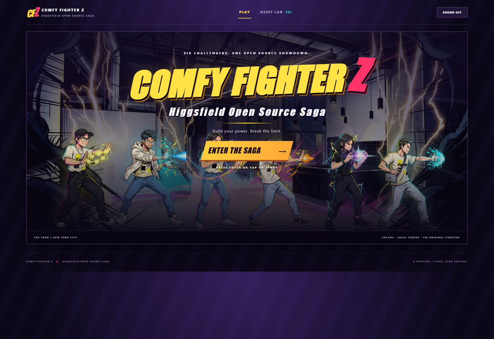

# Comfy Fighter Z — Higgsfield Open Source Saga

A browser fighting game and cloud ComfyUI asset factory, extending the existing Dad Fighter Z inspired game. Six photo-referenced fighters—**Allyson, Deep, Georgia, Matt, The Photographer, and Rob**—fight in one arena: **The Yard**, the indoor venue in `ref/levels/level-theyard.jpeg`.

The saga adds a full-viewport anime title screen and animated pre-fight introductions with original taglines. Choose one of six fighters to face the CPU, with blocking, projectiles, rounds, pause and touch controls. Character descriptions drive the special-move artwork and announcements. The art direction uses bold ink, cel shadows and energetic 1990s battle-anime poses while preserving each person's likeness and outfit.



The included release has 162 fighter poses and 22 audio clips, including six spoken introductions. The animation layer sequences anticipation, contact and recovery poses with breathing, walk cycles, recoil, landing compression and motion trails. Gameplay includes buffered inputs, simultaneous-hit handling, fair blocking, corner collision fixes and a short CPU reaction delay.

The installed opening is a 25-second, 1920×1080 Seedance film with generated audio. It plays before the title; press **Space** to skip. The Yard artwork has clean edges without a speed-line border.

## Clone and play

Requires Node.js 22+:

```powershell
git clone https://github.com/dhaakon/comfy-fight-z.git
cd comfy-fight-z
npm ci
npm run build
npm start
```

Open `http://127.0.0.1:8080`. To use the hackathon preview port, set `$env:PORT='8089'` before `npm start`.

Accepted, optimized WebP/MP3 media is versioned in `public/assets/`. A normal build checks those files and copies the current game into `dist/`; it preserves accepted artwork and makes no model calls. `public/assets/production.json` records the installed asset counts and conversion details. ComfyUI and cloud credentials are only needed to generate new assets.

Workflow files are recipes, not generation receipts. Consult `public/assets/production.json` for installed pose and audio counts. Text introductions remain available if an older accepted bundle lacks the six voiced intro clips; new generated media is adopted after review.

## Generate and customize assets

| File | Purpose |
| --- | --- |
| `comfy-hackathon.json` | Compact factory: six character uploads, three environment slots, shared art and final `assets.json` |
| `comfy-audio.json` | Complete 22-clip audio factory, final `audio.json` |
| `comfy-opening.json` | 25-second Seedance 2.5 opening film with generated audio |
| `config/game.json` | Title/subtitle, six fighters, descriptions, specials, intro taglines/stock voices, one stage and art style |
| `config/factory.json` | Reusable factory defaults: six fighters, the Yard, two empty disabled environment slots |
| `workflows/factory/` | Focused custom-node templates for a character pack, individual sheet or environment |
| `workflows/advanced/full-image-graph.json` | Expanded 114-node factory for inspecting native generation/save nodes |
| `workflows/packs/`, `workflows/jobs/` | Character/environment packs and individual asset workflows |
| `assets/plan.json`, `assets/audio-plan.json` | Generated image and audio output contracts |
| `tools/prepare-saga-patch.cjs` | Incremental art/intro refresh using accepted reference images |

Edit `config/factory.json` for factory defaults, or `config/game.json` for the released game's CLI/audio plans, then regenerate the workflows:

```powershell
npm run workflows
```

This writes workflow JSON, not generated media. Keep defaults in the configuration, compact factory prompt changes in `custom_nodes/dad_fighter_assets/factories.py`, and expanded workflow changes in the generator scripts. Reinstall the custom node pack and restart ComfyUI after editing its Python code; regenerated workflow files are overwritten by this command.

Install the project-owned mapping nodes into your ComfyUI installation, then restart ComfyUI:

```powershell
npm run nodes:install -- --comfy-root "C:\path\to\ComfyUI"
```

Open `comfy-hackathon.json` through ComfyUI/MCP and set **Project Settings** to a new absolute output directory. The twelve functional nodes include six character cards and three environment cards with image upload controls. Upload photos and edit names, descriptions, specials and intro taglines directly on the cards. The Yard is populated; environment slots 2 and 3 stay empty and disabled until you supply their own references. Validate against the live node catalog before running. Source photos feed anime identities, then all 27 poses and selection art. Shared Art creates menus, logo, HUD and effects; the exporter writes their mappings and your edited metadata.

The default factory expands into 49 paid image calls and seven source saves (56 mapped assets). Enabling all three environments produces 51 paid images and nine source saves (60 records), without changing the installed one-Yard game. Audio remains a separate workflow; set its output root to match the image bundle. See [the compact factory guide](docs/workflow-factory.md) for costs, individual-sheet workflows and browser downloads.

All model inference uses cloud/API nodes: Gemini Nano Banana 2.1 images, Seedance 2.5 video, Sonilo music, and ElevenLabs effects and stock voices. No local model weights or voice clones are used. Generating costs credits and requires spending authorization; preparation, validation, file processing and game builds do not. Check live prices before submitting a batch.

For a partial refresh, use [the incremental workflow guide](docs/incremental-refresh.md). It reuses the existing identities, Yard and unaffected assets, merges approved replacements by ID, and supports individual sheet repairs.

## Asset folder to custom game

The workflows produce a portable source folder:

```text
<asset-root>/
  assets.json       # roster, subtitle, taglines, source paths and pose order
  audio.json        # music, effects, announcer, specials and intro calls
  video.json        # optional opening film, duration and SHA-256
  raw/              # content-hashed PNG and WAV files
```

Open `/builder/`, select the complete folder, customize the title, fighter names/selection and accents, and export a standalone directory or ZIP. The builder verifies file hashes, keys green backgrounds, extracts sprites and computes anchors. It retains the original source maps and media. Customizations do not regenerate lettering or recolor baked artwork.

Missing mapped files block a strict export. Audio is optional when no `audio.json` is supplied, and the builder reports that state. A partial patch must be merged into a complete bundle before export.

An optional `video.json` adds the opening movie to the game and retains its source MP4 in exports. See [the opening-film workflow](docs/video-workflow.md) for generation, assembly and the clean Yard edit. The player supports muted autoplay, enabling sound, replay, Space to skip, and a direct transition to the title when the film ends.

For an automated strict export and browser verification:

```powershell
npm run build:bundle -- --bundle "C:\absolute\complete-bundle" --out "C:\absolute\new-export-folder"
```

This requires Playwright Chromium and produces `game/`, `game.zip`, screenshots and `build-test.json`. Extract the ZIP and run `npm start` inside it; no dependencies or ComfyUI connection are needed. Serve the game over HTTP, not `file://`.

To install a verified export matching this repository's canonical six fighters and one Yard stage into the existing game:

```powershell
npm run adopt:game -- --game "C:\absolute\new-export-folder\game"
npm run build
```

Adoption requires FFmpeg on `PATH`. It validates against `config/game.json`, converts runtime media to WebP/MP3, preserves the game code and retains the previous asset folder under `build/adopt-*/previous-assets`. Custom rosters or two/three-environment games should use the builder or `build:bundle` to produce independent game directories/ZIPs; the canonical adoption command does not install arbitrary custom bundles. Keep the portable source bundle separately: optimized runtime media does not replace the original generation records.

`npm run build -- --regenerate-assets` explicitly invokes the older local image-processing pipeline; use it only when intentionally rebuilding from its staged inputs. A normal build preserves the installed runtime.

## Controls and checks

One human player versus the CPU: arrow keys move, jump and crouch; **A** punches, **S** kicks, **D** performs a heavy strike and **F** uses the special. Hold away to block; specials cost 30 meter. Down modifies normal attacks into crouching strikes. Escape pauses during combat. Space skips an opening film or fighter introductions. The fullscreen button enters native fullscreen after a click; the arcade layout also fills the browser viewport. Sound starts after interaction and has a mute control. The Asset lab previews sprites and audio.

```powershell
npm test
npm run test:browser
npm run test:builder
```

Tests make no paid model calls. Browser checks require Playwright Chromium or `PLAYWRIGHT_EXECUTABLE_PATH`. Review generated art for complete limbs, pose order, consistent identity, right-facing attacks, clean keying and foot anchors; listen to voices and music joins before accepting outputs.

See [the asset contract](docs/asset-contract.md) for schemas and all 27 pose names. The read-only reference project is `C:/Users/dhaak/Development/dad-fighter-z-repo`; `npm run export:dfz -- --out exports/dad-fighter-z` stages compatible WebP assets without modifying it.
