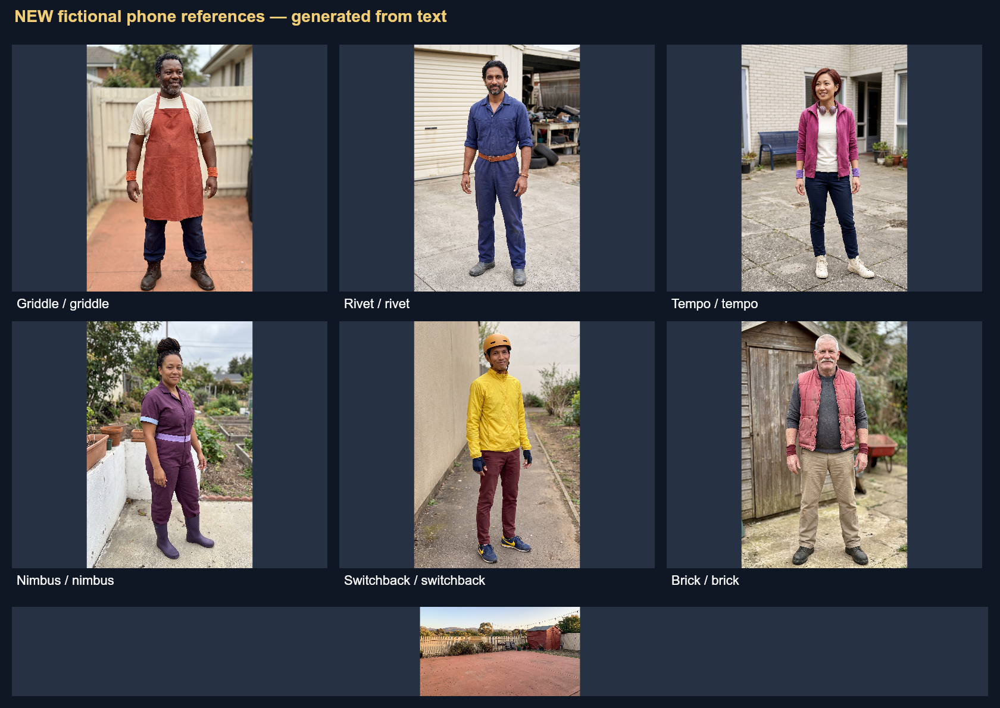

# Phone snapshots → Comfy Fighter Z

This example starts with **six fictional adults and one fictional backyard**, rendered as ordinary phone photographs. ComfyUI invents every photograph from text, then uses those new images to generate a complete anime fighting game. No real-person photos, real venue inputs, or artwork from the earlier example are used.

**Verified game:** all seven source photos and the game artwork passed visual review, including five targeted image repairs and all 162 poses. The complete bundle contains 56 mapped images and 22 game-audio clips. Strict export and keyboard-control checks passed; the public game was checked on desktop and mobile, and all deployed media files match the reviewed export.

The original [included example](../README.md), its `example/bundle/` assets, and `npm run example` stay separate. This folder holds the new example's guide and reviewed reference photos. Its downloadable game ZIP includes the reusable source bundle under `sources/`; a second complete asset bundle is not stored in Git.

## Watch, play, or download

**[Watch the 2:00 narrated walkthrough](https://github.com/dhaakon/comfy-fight-z/releases/download/phone-photo-demo-v1/comfy-fighter-z-phone-photo-demo.mp4)** · **[Play the new game](https://comfy-fight-z.dhaakon.com/phone-photo-demo/)** · **[Download the game ZIP](https://github.com/dhaakon/comfy-fight-z/releases/download/phone-photo-demo-v1/comfy-fighter-z-phone-photo-game.zip)**

[Transcript](https://github.com/dhaakon/comfy-fight-z/releases/download/phone-photo-demo-v1/comfy-fighter-z-phone-photo-demo.transcript.txt) · [Subtitles](https://github.com/dhaakon/comfy-fight-z/releases/download/phone-photo-demo-v1/comfy-fighter-z-phone-photo-demo.srt) · [Video poster](https://github.com/dhaakon/comfy-fight-z/releases/download/phone-photo-demo-v1/comfy-fighter-z-phone-photo-demo.poster.jpg) · [Release page](https://github.com/dhaakon/comfy-fight-z/releases/tag/phone-photo-demo-v1)

Download and extract the ZIP (about **198.6 MiB**). With Node.js 22 or newer installed, open a terminal inside the extracted folder containing `package.json` and run `npm start`. No dependency installation, ComfyUI server, cloud account or generation credits are needed to play.

On Windows PowerShell:

```powershell
Invoke-WebRequest -Uri "https://github.com/dhaakon/comfy-fight-z/releases/download/phone-photo-demo-v1/comfy-fighter-z-phone-photo-game.zip" -OutFile "comfy-fighter-z-phone-photo-game.zip"
Expand-Archive -LiteralPath "comfy-fighter-z-phone-photo-game.zip" -DestinationPath "comfy-fighter-z-phone-photo-game"
Set-Location "comfy-fighter-z-phone-photo-game"
npm start
```

Open the printed URL, normally `http://127.0.0.1:8080/`. Arrow keys move, jump and crouch; **A/S/D/F** punch, kick, strike and use the special. Space skips the fighter introductions. Stop another preview server with Ctrl+C if it already uses that port.

To customize this downloaded game without generating art, start this repository's [builder](../../README.md#1-build-the-included-example), choose **the extracted game's `sources/` folder**, then edit the title, roster, labels or colors and export. `sources/` contains `assets.json`, `audio.json` and their mapped files; choosing only a JSON file is insufficient. The standalone game download does not include the builder itself.

## What the workflow makes

| Phase | Inputs | Outputs |
| --- | --- | --- |
| 1 · Invent phone photos | Text descriptions only | Seven 2K images: Griddle, Rivet, Tempo, Nimbus, Switchback, Brick, and The Yard |
| 2 · Build the game assets | Those seven new uploaded images | 49 anime images and 22 music, effects, and voice clips |
| Review and export | Complete mapped asset folder | Six-fighter browser game, one playable Yard, 162 poses, game directory and ZIP |

The phone photos use natural light, everyday clothes, full bodies, and ordinary backgrounds. The derived fighter sheets use the game's green background for sprite extraction. Each fighter gets three 3×3 sheets, an anime identity, portrait, hero image, and special cut-in. Descriptions and special-move text guide the artwork; combat rules stay shared.

The final bundle contains **56 mapped images**: seven saved source photos plus 49 generated game images. It also contains 22 audio clips. The three environment slots remain available, with only The Yard enabled in this recipe.

## Prepare a fresh run

Use Node.js 22+, run `npm ci` from the repository root, and follow the [ComfyUI setup](../../README.md#2-connect-comfyui). Install the current custom pack, restart ComfyUI, and reload its editor:

```sh
npm run nodes:install -- --comfy-root "<ComfyUI server folder>"
node comfyui/tools/prepare-phone-photo-demo.cjs --out output/phone-photo-demo/my-run --check-live-prices
```

Use the ComfyUI folder containing `main.py` and `nodes.py`. Choose a funded Comfy workspace you are authorized to use. This demonstration uses the operator's personal workspace after the event workspace ran out of spendable credits; those credits are not shared with other installations.

The preparation command only reads live node schemas/prices and writes local workflow files. It never generates or uploads images. Without `--check-live-prices`, preparation can run offline using the recorded estimate. Add `--server <URL>` if ComfyUI is not at `http://127.0.0.1:8188`.

Choose a fresh run name: existing prepared runs are preserved. You receive:

```text
output/phone-photo-demo/my-run/
  phase1-ui.json       Seven text-only photo requests
  phase1-api.json      The same phase for MCP execution
  phase2-ui.json       Photo uploads → complete game art and audio
  phase2-api.json      The same phase for MCP execution
  config.json         Run configuration
  plan.json           Counts, costs, filenames and upload mapping
  prices.json         Live price receipt, when requested
```

The two files under [`comfyui/workflows/phone-photo-demo/`](../../comfyui/workflows/phone-photo-demo/) are muted review templates. Open the **prepared run's** UI files to generate. One Project Settings node supplies a fresh absolute `bundle/` output folder to both image and audio exporters. For a remote ComfyUI server, set that folder to an absolute path on the server.

## Generate new fictional photos

1. Edit the separate [phone-photo configuration](../../comfyui/config/phone-photo-demo.json) before preparing your run. `photoPrompt` describes each realistic snapshot; `description` and `specialMove` describe its anime adaptation. Keep the six fighter IDs, standard sheet layouts, and Yard-only setup.
2. Open `phase1-ui.json`. It has seven native cloud generation nodes and seven image saves, with **no image inputs**.
3. Review the plan and authorize the cloud spend before queueing through the MCP. Inspect every result: one clearly adult person, visible hands and complete shoes, a readable outfit, and no identifying text. Check that The Yard has clear, flat fighting space.
4. Download the seven accepted outputs. `plan.json` maps each save's `downloadPattern` to `references/<id>.png` and an exact `uploadFilename`.
5. Upload these new files to the running ComfyUI server. For MCP execution, use each exact filename in the plan, such as `cfz-phone-my-run-griddle.png`. Then validate the prepared Phase 2 graph against that server.

The seven generated references are the only image inputs to Phase 2. Do not substitute earlier session photos or unrelated game sheets.

## Use the reviewed sample photos or your own artwork

These seven reviewed synthetic photographs are included in `references/`. They depict fictional people and a fictional location; they are not photographs of real subjects.



| Character or environment | Original PNG |
| --- | --- |
| Griddle | [griddle.png](references/griddle.png) |
| Rivet | [rivet.png](references/rivet.png) |
| Tempo | [tempo.png](references/tempo.png) |
| Nimbus | [nimbus.png](references/nimbus.png) |
| Switchback | [switchback.png](references/switchback.png) |
| Brick | [brick.png](references/brick.png) |
| The Yard | [yard.png](references/yard.png) |

The seven original PNGs total about **43.5 MiB** and are copied without modification. [Provenance](references/provenance.json) records their hashes, generation prompts, model, date, and text-only origin. The smaller preview is a labeled contact sheet; no additional model generation was used to create it.

To regenerate game art from those reviewed images, prepare a fresh run as above and **skip Phase 1**. You can also supply your own original fictional character artwork and background through the same controls:

1. Open the prepared `phase2-ui.json` in ComfyUI.
2. In each **Character Factory**, keep `source_mode` set to **Upload reference**. Use the upload control beside **`image`** and confirm the uploaded filename is selected. Uploading through the editor updates the selector; you do not need to rename files or edit a mapping JSON by hand.
3. Match `name` and `description` to the selected character. Edit `special_name`, `special_description`, and `intro_tagline`; keep `character_id` stable and **`include_sprite_sheets` enabled** in the advanced fields.
4. In **Environment 1**, keep `enabled` on and `source_mode` on **Upload reference**. Upload the Yard/background through `image`, then set its `name` and `description`. Keep Environments 2 and 3 disabled for this recipe. Environment 1 also drives the title and selection artwork.
5. Keep the reference files inside ComfyUI's input system by using its upload control. Select their uploaded filenames instead of typing arbitrary absolute image paths. **Invent fictional reference** ignores the image selector, so leave the active cards in Upload mode.
6. Validate the edited workflow, review its cost, and generate. Both exporters write into the Project Settings folder; no hand-authored `assets.json` or `audio.json` is needed.

For matching spoken special calls and introductions, edit the configuration **before** preparing the run. Later canvas changes to character fields do not rewrite the separate audio-node prompts automatically. Uploaded reference images are saved into the bundle and retained in exported game sources, so use artwork you intend to distribute.

## Review, build, and download

Wait for both exporters to finish. Keep the full folder together:

```text
bundle/
  assets.json
  audio.json
  raw/
```

Check all 18 fighter sheets and 162 poses for duplicate bodies, missing limbs, clipping, identity drift, and green costume details. Listen to the 22 clips. If the local builder is not running yet, run `npm run example` followed by `npm start`; this serves the included example and builder without model calls. It does not alter your new generation bundle.

Open the [browser builder](http://127.0.0.1:8080/builder/), choose the complete new bundle folder, and leave **Allow placeholder assets** unchecked. Build and export the game directory or ZIP. The builder also lets you change labels and interface colors without regenerating art.

The separate 120-second narrated walkthrough documents this photo-to-game process. It is a tutorial video, not an opening film inserted into the game. Video, transcript and subtitle downloads are linked above.

## Generation estimate

| Work in this reviewed run | Calls or clips | Recorded estimate |
| --- | ---: | ---: |
| New 2K phone photos | 7 images | $0.504504 |
| Derived game artwork | 49 images | $2.834832 |
| Three sheet repairs, logo and energy-crest repairs | 5 images | $0.312312 |
| Game music, effects and voices | 22 audio clips | $0.424749867 |
| Walkthrough narration | 10 speech clips | $0.219648 |
| **Reviewed game and walkthrough total** | **61 images + 32 audio clips** | **$4.296045867 ≈ $4.30** |

The five repairs replace existing image IDs, so the accepted game still has **56 mapped images and 22 audio clips**. Narration belongs to the walkthrough and is not added to the game's audio manifest. All 18 sheets and 162 poses passed visual review. Verification includes **150 JavaScript tests, 14 Python factory tests, strict game export, keyboard controls and deployed-media checks**; the public page was also checked on mobile.

A new run before repairs or narration is estimated at **$3.76**; generating game art/audio from already accepted uploaded photos is about **$3.26**. These are recorded November 3, 2026 Comfy node estimates, not actual provider charges. Fresh `plan.json` and optional `prices.json` files contain the calculation, and billing can vary. Preparation, uploads, local review and export make no model calls.
